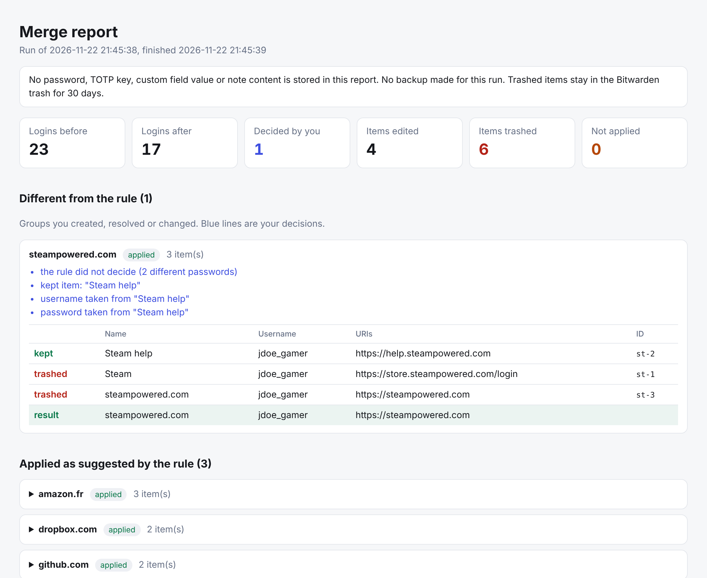

<div align="center">

# Bitwarden Duplicate Merger

**Find and merge duplicate logins in your Bitwarden vault, with a review screen before anything changes.**

[](https://github.com/ThomLaurent/bitwarden-duplicate-merger/actions/workflows/tests.yml)
[](https://github.com/ThomLaurent/bitwarden-duplicate-merger/releases/latest)


[](LICENSE)

English · [Français](docs/translations/README.fr.md) · [Español](docs/translations/README.es.md) · [Deutsch](docs/translations/README.de.md) · [简体中文](docs/translations/README.zh-CN.md)


</div>

After importing passwords from a browser or another password manager, a vault often holds the same account several times: `www.amazon.fr`, `login.amazon.fr` and `amazon.fr/ap/signin`, all with the same username and password. Bitwarden has no built-in way to merge them, and doing it by hand for hundreds of logins takes hours.

This tool groups those duplicates, suggests how to merge each group, lets you check and change every decision in a local web page, then applies only what you validated, through the official Bitwarden CLI.

## How it works

1. **Start the tool.** The Bitwarden CLI unlocks your vault and a page opens in your browser.
2. **Review the suggestions.** Logins with the same domain and username are grouped. Groups the rule cannot decide alone (different passwords, passkeys...) are flagged for you.
3. **Change anything**: which item to keep, name, password, TOTP, notes, URIs, which items to leave out. Group logins by hand when needed (`ebay.fr` and `ebay.com`).
4. **Stop and resume any time.** Decisions are saved to a file, even across reboots.
5. **Apply** all validated groups, or a few at a time. A report lists what was done, starting with what you decided differently from the rule.



## Guarantees

- **Your master password never reaches the tool.** Only the Bitwarden CLI reads it; the tool receives the session key and keeps it in memory.
- **Secrets are never written to disk or logged.** Passwords, TOTP keys, field values and notes are compared in memory. The page shows one only when you click "show".
- **Nothing changes without your validation**, and only the groups you validated are applied.
- **No stale plan.** Right before each group is applied, the tool checks with Bitwarden that none of its items changed since your review. Changed groups are skipped and reported.
- **Reversible.** Duplicates go to the Bitwarden trash (30 days), kept items keep their ID, attachments and passkeys, and an encrypted backup is made before applying.
- **Local only.** The page is served on `127.0.0.1` with a random token. No network access other than `bw` talking to your Bitwarden server, and the download of `bw` below.
- **Official Bitwarden CLI.** If `bw` is not installed, the tool offers to download it from Bitwarden's releases on GitHub and checks its SHA-256. It keeps that copy up to date, checking once a month.
- **Small and readable.** About 2,300 lines of Python and JavaScript, standard library only, no dependency to audit.

## Quick start

<details open>
<summary><b>Windows</b></summary>

1. Download **`bw-dedupe-windows-x64.exe`** from the [latest release](https://github.com/ThomLaurent/bitwarden-duplicate-merger/releases/latest).
2. Move it to a folder of its own, for example a new `bw-dedupe` folder in Documents. Your decisions and reports are saved next to it.
3. Double-click it. If Windows shows "Windows protected your PC", click **More info**, then **Run anyway**: the file is not signed.
4. A black window opens. The first time, it offers to download the official Bitwarden command-line tool: press Enter. To look around on a made-up vault first, type `D` then Enter.
5. Choose where your account is (bitwarden.com, bitwarden.eu or your own server), then sign in: email, master password, and two-step login code if you use one. Nothing shows while you type the password, that is normal.
6. The review page opens in your browser.

</details>

<details>
<summary><b>macOS</b></summary>

1. Download **`bw-dedupe-macos-arm64.zip`** from the [latest release](https://github.com/ThomLaurent/bitwarden-duplicate-merger/releases/latest). It runs on Macs with an Apple chip (M1 or later); on an Intel Mac, run from source.
2. Open the zip if Safari did not already, then move `bw-dedupe-macos-arm64` to a folder of its own, for example a new `bw-dedupe` folder in Documents. Your decisions and reports are saved next to it.
3. Double-click it. The first time, macOS refuses because the file is not signed: click **Done**, open **System Settings**, then **Privacy & Security**, scroll down and click **Open Anyway**, then confirm.
4. A Terminal window opens. The first time, it offers to download the official Bitwarden command-line tool: press Enter. To look around on a made-up vault first, type `D` then Enter.
5. Choose where your account is (bitwarden.com, bitwarden.eu or your own server), then sign in: email, master password, and two-step login code if you use one. Nothing shows while you type the password, that is normal.
6. The review page opens in your browser.

</details>

<details>
<summary><b>Linux</b></summary>

Download **`bw-dedupe-linux-x64`** from the [latest release](https://github.com/ThomLaurent/bitwarden-duplicate-merger/releases/latest), then in a terminal:

```bash
chmod +x bw-dedupe-linux-x64
```
```bash
./bw-dedupe-linux-x64
```

The first time, the tool offers to download the official Bitwarden CLI, or to try a demo vault. Sign in when `bw` asks, then review in the browser page that opens.

</details>

<details>
<summary><b>From source</b> (any system with Python 3.10+)</summary>

Nothing to install:

```bash
git clone https://github.com/ThomLaurent/bitwarden-duplicate-merger
```
```bash
cd bitwarden-duplicate-merger
```
```bash
python bw_dedupe.py
```

</details>

**Try it first** on a made-up vault, without the Bitwarden CLI or an account: type `D` when the tool offers to download the CLI, or start it from a terminal with `--demo` (for example `python bw_dedupe.py --demo`). Nothing is saved to any vault.

Executables bundle their own Python, so they keep working whatever Python you have, as long as `bw` keeps its commands. Each one is built by GitHub Actions from this repository and can be checked with:

```bash
gh attestation verify bw-dedupe-windows-x64.exe --repo ThomLaurent/bitwarden-duplicate-merger
```

More: [usage guide](docs/USAGE.md) (review, rule, options, undo, troubleshooting).

## Project status

This tool is shared **as is** and will probably not be improved. I built it to clean my own vault, and I thought it better to share it openly than to keep it to myself. I hope it saves you the time and tokens of building the same thing, and above all the hours of merging hundreds of logins by hand.

Issues and pull requests may not get an answer. Forks are welcome: the code is in the public domain ([Unlicense](LICENSE)), and [AGENTS.md](AGENTS.md) explains it to you and to AI coding assistants.

Not affiliated with Bitwarden, Inc. "Bitwarden" is a trademark of Bitwarden, Inc.
