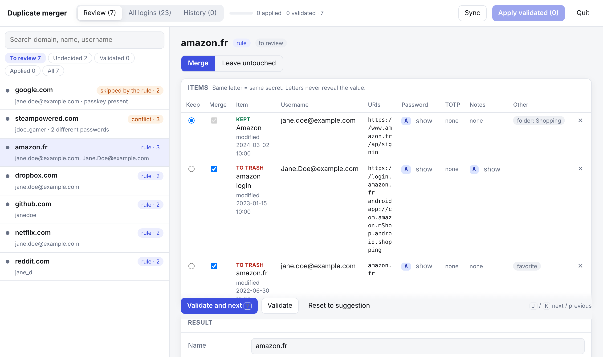

# Usage guide

## Start

Step-by-step instructions for Windows, macOS and Linux are in the [README](../README.md#quick-start).

Standalone executable: double-click it (Windows), or run it from a terminal:

```bash
./bw-dedupe-linux-x64
```

From source (Python 3.10 or later, no package to install):

```bash
python bw_dedupe.py
```

- If the vault is locked, `bw` asks for your master password in the terminal (and for your email and two-step login code the first time).
- If the tool is not started from a terminal, or the vault gets locked while you work, it opens a terminal window for `bw` and gets the session key back once you are done.
- Run it again from the same folder to resume: decisions are stored in `bw-dedupe-session.json`.
- The vault is locked when you quit, unless `BW_SESSION` was already set or `--keep-unlocked` is passed.
- Self-hosted servers: run `bw config server https://your.server` once before. Not tested, but the tool only uses standard `bw` commands.

### Bitwarden CLI

The tool looks for `bw` in this order: `--bw <path>`, your `PATH`, then a copy it downloaded earlier. When none is found, it asks before downloading one:

- from the newest stable `cli-v*` release of [bitwarden/clients](https://github.com/bitwarden/clients/releases) on GitHub, for your system;
- checked against the SHA-256 that GitHub publishes for the file, or Bitwarden's own checksum file. Nothing is saved when they differ;
- saved to `%LOCALAPPDATA%\bw-dedupe` (Windows), `~/Library/Caches/bw-dedupe` (macOS) or `~/.cache/bw-dedupe` (Linux).

Once a month, the tool checks for a newer release and updates that copy the same way. If the check fails, it keeps the current copy. A `bw` you installed yourself is never updated. Delete the folder to remove the downloaded copy.

### Demo

`--demo` starts the tool on a made-up vault, without `bw` or a Bitwarden account: to see how it works, or to audit it. Merges change the demo vault in memory only, and the work file and reports go to a temporary folder printed at start.

## Review



Each group lists its items with:
- **Keep**: the item that is edited and stays in the vault. Its ID, attachments and passkeys are preserved.
- **Merge**: unchecked items are left untouched. Checked ones go to the Bitwarden trash.
- Letters (`A`, `B`...) in the Password, TOTP and Notes columns: items with the same letter hold the same value. The value itself is only shown with "show".

The **Result** section sets the name, username, password, TOTP key, notes and URIs of the kept item. Custom fields of all merged items, favorite, folder and master password re-prompt are merged automatically.

Other actions:
- **Leave untouched**: nothing changes, and the rule no longer suggests these items.
- **✕** on an item: takes it out of the group. The rule no longer suggests it.
- **All logins** tab: select logins to group them by hand (for example `amazon.fr` and `amazon.com`), or rename them after their domain.
- Shortcuts: `J` / `K` next / previous group, `V` validate and go to the next one, `/` search.

## Apply

**Apply validated** applies the validated groups only, so you can apply a few groups, check the result in Bitwarden, then continue. Before each group, the tool syncs with Bitwarden and checks that none of its items changed since your review. Changed groups are skipped, listed in the report and come back to review.

An encrypted backup (`bw export --format encrypted_json`) is made first unless you uncheck it. `bw` may ask for your master password in the terminal for it.

## Reports

Each run writes `bw-dedupe-reports/bw-dedupe-report-<date>.html`, which opens without the tool. The **History** tab reopens them. A report shows:
- what differs from the rule: groups you created, resolved or changed, with your decisions;
- what was not applied (item changed in the vault, `bw` error);
- the merges applied as suggested;
- the `bw restore item <id>` commands to bring trashed items back.

## Options

| Option | Effect |
|---|---|
| `--workfile <path>` | Work file holding your decisions. Default: `bw-dedupe-session.json`. |
| `--reports <path>` | Folder for reports and backups. Default: `bw-dedupe-reports`. |
| `--port <n>` | Local port. Default: random. |
| `--no-browser` | Does not open the browser; open the printed link yourself. |
| `--keep-unlocked` | Does not lock the vault when quitting. |
| `--bw <path>` | Path of the `bw` executable. Default: found in `PATH`, or downloaded (see [Bitwarden CLI](#bitwarden-cli)). |
| `--demo` | Made-up vault, no `bw` or account needed (see [Demo](#demo)). |

## Rule

Two logins are suggested as duplicates when they have:
- the same registrable domain: `login.amazon.fr` and `www.amazon.fr/ap/signin` both give `amazon.fr`. Private suffixes are respected: `alice.github.io` and `bob.github.io` stay separate;
- the same username, ignoring surrounding whitespace and case.

Suggested merge:
- **Kept item**: the one with attachments if there is one, otherwise the most recently modified.
- **Name**: the domain, for example `amazon.fr`. Bitwarden already shows the username next to it.
- **URIs**: a single `https://<domain>` URI with "base domain" match detection, plus app URIs (`androidapp://`, etc.). `http` is kept only if all the original URIs used `http`.
- **Taken from the others**: distinct notes (separated by `----`), missing custom fields, TOTP key if the kept item has none.

The rule does not decide, and leaves the group to you, when:

| Case | Why |
|---|---|
| Different passwords | One may be outdated. |
| Different TOTP keys | Same. |
| A passkey in the group | Passkeys cannot be moved; the tool checks the kept item still has its passkey after the edit and deletes nothing otherwise. |
| Attachments on several items | The CLI cannot move an attachment. |

Never suggested: items with several domains, organization items, items without a usable web URI (app only, IP, `localhost`). The first and last can still be grouped by hand.

## Undo

- **Trashed items**: restore them from the Bitwarden trash within 30 days, or with the commands in the report.
- **Full rollback**, including kept items: re-import the encrypted backup. It can only be imported into the same account. Delete it once you have checked the result.

## Troubleshooting

| Symptom | Fix |
|---|---|
| `The Bitwarden CLI (bw) was not found` | Start the tool from a terminal so it can offer the download, install the [Bitwarden CLI](https://bitwarden.com/help/cli/) yourself, or pass `--bw <path>`. |
| `Download failed` | No access to GitHub (proxy, firewall), or the file did not match its SHA-256. Install the [Bitwarden CLI](https://bitwarden.com/help/cli/) yourself, or pass `--bw <path>`. |
| No terminal window opens to unlock | Start the tool from a terminal, or run `bw unlock`, set `BW_SESSION` and start it again. |
| macOS: "cannot be opened because the developer cannot be verified" | `xattr -d com.apple.quarantine bw-dedupe-macos-arm64`, or run from source. |
| Windows SmartScreen warning | The executable is not signed. "More info", then "Run anyway", or run from source. |
| Linux: `GLIBC_x.y not found` | Your distribution is older than the build machine: run from source. |
| A group says "changed in vault" | An item was edited elsewhere since your review. Review it again. |
