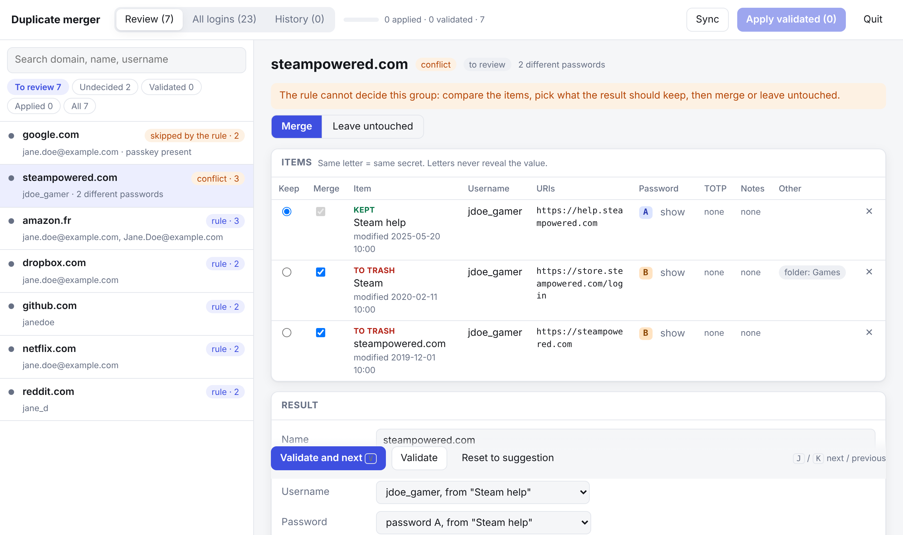

<div align="center">

# Bitwarden Duplicate Merger

**Trouve et fusionne les identifiants en double de ton coffre Bitwarden, avec un écran de revue avant toute modification.**

[](https://github.com/ThomLaurent/bitwarden-duplicate-merger/actions/workflows/tests.yml)
[](https://github.com/ThomLaurent/bitwarden-duplicate-merger/releases/latest)


[](../../LICENSE)

[English](../../README.md) · Français · [Español](README.es.md) · [Deutsch](README.de.md) · [简体中文](README.zh-CN.md)



</div>

Après un import depuis un navigateur ou un autre gestionnaire, un coffre contient souvent plusieurs fois le même compte : `www.amazon.fr`, `login.amazon.fr` et `amazon.fr/ap/signin`, avec le même identifiant et le même mot de passe. Bitwarden ne sait pas les fusionner, et le faire à la main pour des centaines d'identifiants prend des heures.

Cet outil regroupe ces doublons, propose une fusion pour chaque groupe, te laisse vérifier et modifier chaque décision dans une page web locale, puis applique uniquement ce que tu as validé, via la CLI officielle de Bitwarden.

## Fonctionnement

1. **Lance l'outil.** La CLI Bitwarden déverrouille le coffre et une page s'ouvre dans ton navigateur.
2. **Relis les suggestions.** Les identifiants de même domaine et même nom d'utilisateur sont regroupés. Les groupes que la règle ne sait pas trancher (mots de passe différents, passkeys...) te sont signalés.
3. **Modifie ce que tu veux** : élément conservé, nom, mot de passe, TOTP, notes, URIs, éléments à laisser de côté. Regroupe des identifiants à la main si besoin (`ebay.fr` et `ebay.com`).
4. **Arrête et reprends quand tu veux.** Les décisions sont enregistrées dans un fichier, même après un redémarrage.
5. **Applique** tous les groupes validés, ou quelques-uns. Un rapport liste ce qui a été fait, en commençant par ce que tu as décidé autrement que la règle.

## Garanties

- **Ton mot de passe maître n'atteint jamais l'outil.** Seule la CLI Bitwarden le lit ; l'outil reçoit la clé de session et la garde en mémoire.
- **Aucun secret n'est écrit sur disque ni journalisé.** Mots de passe, clés TOTP, champs et notes sont comparés en mémoire. La page n'en affiche un que si tu cliques sur « show ».
- **Rien ne change sans ta validation**, et seuls les groupes validés sont appliqués.
- **Pas de plan périmé.** Juste avant chaque groupe, l'outil vérifie auprès de Bitwarden qu'aucun élément n'a changé depuis ta revue. Sinon le groupe est sauté et signalé.
- **Réversible.** Les doublons vont dans la corbeille Bitwarden (30 jours), les éléments conservés gardent leur ID, pièces jointes et passkeys, et une sauvegarde chiffrée est faite avant d'appliquer.
- **Local uniquement.** La page est servie sur `127.0.0.1` avec un jeton aléatoire. Aucun accès réseau hormis `bw` vers ton serveur Bitwarden, et le téléchargement de `bw` ci-dessous.
- **CLI Bitwarden officielle.** Si `bw` n'est pas installé, l'outil propose de le télécharger depuis les releases de Bitwarden sur GitHub et vérifie son SHA-256. Il tient cette copie à jour en vérifiant une fois par mois.
- **Petit et lisible.** Environ 2 300 lignes de Python et JavaScript, bibliothèque standard uniquement, aucune dépendance à auditer.

## Démarrage rapide

<details open>
<summary><b>Windows</b></summary>

1. Télécharge **`bw-dedupe-windows-x64.exe`** dans la [dernière release](https://github.com/ThomLaurent/bitwarden-duplicate-merger/releases/latest).
2. Range-le dans un dossier à lui, par exemple un nouveau dossier `bw-dedupe` dans Documents. Tes décisions et rapports sont enregistrés à côté.
3. Double-clique dessus. Si Windows affiche « Windows a protégé votre ordinateur », clique sur **Informations complémentaires**, puis **Exécuter quand même** : le fichier n'est pas signé.
4. Une fenêtre noire s'ouvre. La première fois, elle propose de télécharger l'outil en ligne de commande officiel de Bitwarden : appuie sur Entrée.
5. Connecte-toi à Bitwarden dans cette fenêtre : e-mail, mot de passe maître, et code de connexion en deux étapes si tu en utilises un. Rien ne s'affiche pendant que tu tapes le mot de passe, c'est normal.
6. La page de revue s'ouvre dans ton navigateur.

</details>

<details>
<summary><b>macOS</b></summary>

1. Télécharge **`bw-dedupe-macos-arm64`** dans la [dernière release](https://github.com/ThomLaurent/bitwarden-duplicate-merger/releases/latest). Il fonctionne sur les Mac à puce Apple (M1 ou plus récent) ; sur un Mac Intel, lance-le depuis les sources.
2. Ouvre l'app Terminal, puis lance ces commandes une par une. La deuxième permet à macOS de lancer un fichier non signé.
   ```bash
   cd ~/Downloads
   ```
   ```bash
   chmod +x bw-dedupe-macos-arm64 && xattr -d com.apple.quarantine bw-dedupe-macos-arm64
   ```
   ```bash
   ./bw-dedupe-macos-arm64
   ```
3. La première fois, l'outil propose de télécharger l'outil en ligne de commande officiel de Bitwarden : appuie sur Entrée.
4. Connecte-toi à Bitwarden dans le Terminal : e-mail, mot de passe maître, et code de connexion en deux étapes si tu en utilises un. Rien ne s'affiche pendant que tu tapes le mot de passe, c'est normal.
5. La page de revue s'ouvre dans ton navigateur.

</details>

<details>
<summary><b>Linux</b></summary>

Télécharge **`bw-dedupe-linux-x64`** dans la [dernière release](https://github.com/ThomLaurent/bitwarden-duplicate-merger/releases/latest), puis dans un terminal :

```bash
chmod +x bw-dedupe-linux-x64
```
```bash
./bw-dedupe-linux-x64
```

La première fois, l'outil propose de télécharger la CLI Bitwarden officielle. Connecte-toi quand `bw` le demande, puis fais ta revue dans la page qui s'ouvre.

</details>

<details>
<summary><b>Depuis les sources</b> (tout système avec Python 3.10+)</summary>

Rien à installer :

```bash
git clone https://github.com/ThomLaurent/bitwarden-duplicate-merger
```
```bash
cd bitwarden-duplicate-merger
```
```bash
python bw_dedupe.py
```

</details>

**Essaie d'abord** sur un coffre fictif, sans CLI Bitwarden ni compte : lance-le depuis un terminal avec `--demo`, par exemple `python bw_dedupe.py --demo`. Rien n'est enregistré dans aucun coffre.

Les exécutables embarquent leur propre Python : ils continuent de fonctionner quel que soit ton Python, tant que `bw` garde ses commandes. Chacun est construit par GitHub Actions depuis ce dépôt et se vérifie avec :

```bash
gh attestation verify bw-dedupe-windows-x64.exe --repo ThomLaurent/bitwarden-duplicate-merger
```

Détails (en anglais) : [guide d'utilisation](../USAGE.md).

## État du projet

Cet outil est partagé **tel quel** et ne sera probablement pas amélioré. Je l'ai fait pour nettoyer mon propre coffre, et j'ai préféré le partager ouvertement plutôt que le garder pour moi. J'espère qu'il t'évitera le temps et les tokens nécessaires pour construire la même chose, et surtout les heures à fusionner des centaines d'identifiants à la main.

Les issues et pull requests risquent de rester sans réponse. Les forks sont les bienvenus : le code est dans le domaine public ([Unlicense](../../LICENSE)), et [AGENTS.md](../../AGENTS.md) l'explique à toi comme aux assistants de code IA.

Projet sans lien avec Bitwarden, Inc. « Bitwarden » est une marque de Bitwarden, Inc.
